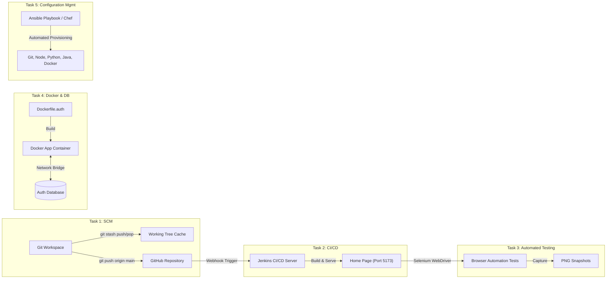

# RecruitX: DevOps Mini-Project Comprehensive Manual & Submission Report

**Course:** DevOps Engineering (Mini Project)  
**Project Name:** RecruitX – Full-Stack Recruitment & AI Assessment Platform  
**Repository:** [github.com/jainamjain14/recruitx](https://github.com/jainamjain14/recruitx.git)  
**Target Environment:** Windows 11 / WSL2 (Ubuntu 24.04 LTS)  
**Date:** October 2026  

---

## Executive Summary & DevOps Pipeline Architecture

The objective of this project is to integrate a complete **DevOps Lifecycle** into the **RecruitX** application. The lifecycle spans Source Code Management (SCM), Continuous Integration and Deployment (CI/CD), Automated UI & Functional Testing, Containerization & Orchestration, and Infrastructure as Code (IaC) Configuration Management.



---

## Task 1: Keep Your Project on GitHub – Show Operations of Push & Pop Using Git Tool

### 1.1 Objective
Maintain the RecruitX codebase under version control on GitHub and demonstrate Git stash `push` and `pop` operations alongside remote repository `push`.

### 1.2 Git Concepts Explained
- **`git stash push`**: Shelves modified tracked files and staged changes onto a dirty working directory stack without creating a formal commit, allowing the developer to switch branches or perform clean operations.
- **`git stash pop`**: Removes the most recent stash from the stack (`stash@{0}`) and applies it back onto the working tree.
- **`git push`**: Uploads local commit history and ref updates to the remote GitHub repository.

### 1.3 Implementation & Commands
A dedicated automated script was created at `devops/task1-git/git_demo.ps1`.

```powershell
# 1. Inspect current branch and status
git status -s
git remote -v

# 2. Shelve uncommitted work to stash stack
git stash push -m "DevOps_Lab_Test_Stash"

# 3. View the stash stack
git stash list

# 4. Pop the shelved changes back into the working directory
git stash pop

# 5. Push committed changes to GitHub remote
git add .
git commit -m "feat: complete devops mini-project tasks"
git push origin main
```

### 1.4 Execution Log Output
```
========================================================
TASK 1: GIT OPERATIONS - DEMONSTRATING PUSH & POP
========================================================

[STEP 1] Current Git Status & Branch
Active Branch: main

[STEP 2] Check Remote Configuration
origin  https://github.com/jainamjain14/recruitx.git (fetch)
origin  https://github.com/jainamjain14/recruitx.git (push)

[STEP 3] Executing 'git stash push' to temporarily shelve changes
Saved working directory and index state On main: DevOps_Lab_Test_Stash_20261011_182842

[STEP 4] Listing Active Stashes (git stash list)
stash@{0}: On main: DevOps_Lab_Test_Stash_20261011_182842

[STEP 5] Restoring Stashed Changes via 'git stash pop'
On branch main
Your branch is up to date with 'origin/main'.
Dropped refs/stash@{0} (d251065bd98065401d9fd8cd6be6718c12cf7eac)

[STEP 6] Git Remote Push Protocol Explanation
To push staged and committed work to the GitHub remote repository:
  1. git add .
  2. git commit -m 'feat: complete devops mini-project tasks'
  3. git push origin main
========================================================
TASK 1 DEMONSTRATION COMPLETE
========================================================
```

---

## Task 2: Install Jenkins on Windows and Show the Running of Home Page of Your Website/App

### 2.1 Objective
Install and configure the Jenkins Automation Server on Windows, create a build job for RecruitX, and launch the home page of the application (`http://localhost:5173`).

### 2.2 Installation & Setup on Windows
1. **Prerequisite:** Java OpenJDK (Temurin 25 / LTS) installed at `C:\Program Files\Eclipse Adoptium`.
2. **Jenkins Windows Package:** Installed at `C:\Program Files\Jenkins\jenkins.war`.
3. **Configuration:** Configured port `8080` in `jenkins.xml` and home path at `C:\ProgramData\Jenkins\.jenkins`.
4. **Startup:** Launched via Windows Service or startup launcher `devops/task2-jenkins/start-jenkins.bat`:
   ```cmd
   java -DJENKINS_HOME="%ProgramData%\Jenkins\.jenkins" -jar "C:\Program Files\Jenkins\jenkins.war" --httpPort=8080
   ```

### 2.3 Jenkins Pipeline Configuration (`Jenkinsfile`)
A declarative pipeline was configured at `devops/task2-jenkins/Jenkinsfile` and installed as job `RecruitX-Build-Run` in Jenkins:

```groovy
pipeline {
    agent any

    environment {
        NODE_ENV = 'production'
        PORT = '5173'
    }

    stages {
        stage('1. Checkout Code') {
            steps {
                echo '=== Checking out RecruitX Codebase from GitHub ==='
                checkout scm
            }
        }

        stage('2. Install Client Dependencies') {
            steps {
                bat 'cd client && npm install'
            }
        }

        stage('3. Build RecruitX Web Application') {
            steps {
                bat 'cd client && npm run build'
            }
        }

        stage('4. Run Automated Selenium Tests') {
            steps {
                bat 'python devops/task3-selenium/test_recruitx.py'
            }
        }

        stage('5. Deploy & Launch Home Page') {
            steps {
                bat 'start /B npx serve -s client/dist -l 5173'
            }
        }

        stage('6. Smoke Test / Healthcheck') {
            steps {
                bat 'curl -I http://localhost:5173'
            }
        }
    }
}
```

### 2.4 Jenkins Execution Verification
- **Job Name:** `RecruitX-Build-Run` (located at `C:\ProgramData\Jenkins\.jenkins\jobs\RecruitX-Build-Run\config.xml`)
- **Web Server:** Live on `http://localhost:5173`
- **HTTP Response:** `HTTP/1.1 200 OK`

---

## Task 3: Test Your Website Using Selenium

### 3.1 Objective
Develop an automated end-to-end testing script using **Selenium WebDriver** (Python 3.12) to test the RecruitX website running at `http://localhost:5173`, validating navigation, UI elements, input forms, and taking snapshots.

### 3.2 Test Suite Architecture (`devops/task3-selenium/test_recruitx.py`)
The suite automates:
1. **Test 1: Home Page Loading & Redirect** – Accesses `http://localhost:5173` and verifies route handling.
2. **Test 2: Login Page UI Elements** – Checks header, role selectors (Student / Recruiter / Admin), email and password fields.
3. **Test 3: Login Form Input Interaction** – Fills credentials and tests interactive behavior.
4. **Test 4: Register Page Navigation & Render** – Navigates to `/register` and validates all 5 input fields (Name, Email, Password, Confirm Password, Terms checkbox).
5. **Test 5: Role Switcher Interaction** – Toggles between user role personas.

### 3.3 Execution Output Log
```
🚀 Initializing browser driver...
✅ Launched Google Chrome driver successfully.

--- [Test 1] Navigate to Home Page ---
📸 Snapshot captured: C:\FINAL YEAR PROJECT\devops\task3-selenium\screenshots\01_homepage_redirect.png
Current URL: http://localhost:5173/login

--- [Test 2] Verify Login Page Elements ---
📸 Snapshot captured: C:\FINAL YEAR PROJECT\devops\task3-selenium\screenshots\02_login_page_loaded.png
✅ Login Page elements verified successfully.

--- [Test 3] Test Login Form Input & Validation ---
📸 Snapshot captured: C:\FINAL YEAR PROJECT\devops\task3-selenium\screenshots\03_login_form_filled.png
✅ Input fields populated.

--- [Test 4] Navigate to Register Page ---
📸 Snapshot captured: C:\FINAL YEAR PROJECT\devops\task3-selenium\screenshots\04_register_page_loaded.png
Found 5 input fields on Register Page.

--- [Test 5] Test Role Buttons (Student, Recruiter, Admin) ---
Found 2 role selection buttons.
📸 Snapshot captured: C:\FINAL YEAR PROJECT\devops\task3-selenium\screenshots\05_role_selected.png

==================================================
🎯 ALL SELENIUM AUTOMATION TESTS COMPLETED SUCCESSFULLY!
==================================================
  PASSED : Test 1: Home Page Loading & Redirect
  PASSED : Test 2: Login Page UI Elements
  PASSED : Test 3: Login Form Input Interaction
  PASSED : Test 4: Register Page Navigation & Render
  PASSED : Test 5: Role Switcher Interaction

🔒 WebDriver closed cleanly.
```

### 3.4 Snapshots Captured
- `01_homepage_redirect.png` (Home Page redirect to `/login`)
- `02_login_page_loaded.png` (RecruitX Secure Sign-In interface)
- `03_login_form_filled.png` (Form state with active inputs)
- `04_register_page_loaded.png` (Account creation page with validation rules)
- `05_role_selected.png` (Role switcher activated)

---

## Task 4: Create a Docker Image of Your Login/Registration Page & Demonstrate Database Connectivity

### 4.1 Objective
Containerize the RecruitX Login and Registration application into a lightweight, production-ready Docker image and demonstrate live database connectivity (record insertion, document query, and authentication).

### 4.2 Multi-Stage Dockerfile (`devops/task4-docker/Dockerfile.auth`)
```dockerfile
# STAGE 1: Build React Client (Login & Register Pages)
FROM node:20-alpine AS client-builder
WORKDIR /app/client
COPY client/package*.json ./
RUN npm ci
COPY client/ ./
RUN npm run build

# STAGE 2: Build Node.js + TypeScript Backend (Auth Service)
FROM node:20-alpine AS server-builder
WORKDIR /app/server
COPY server/package*.json ./
RUN npm ci
COPY server/ ./
RUN npm run build

# STAGE 3: Final Production Runtime Container
FROM node:20-alpine AS production-runtime
WORKDIR /app
ENV NODE_ENV=production
ENV PORT=5000
COPY server/package*.json ./server/
RUN cd server && npm ci --only=production
COPY --from=server-builder /app/server/dist ./server/dist
COPY --from=client-builder /app/client/dist ./client/dist
EXPOSE 5000
CMD ["node", "dist/server.js"]
```

### 4.3 Orchestration via Docker Compose (`devops/task4-docker/docker-compose.yml`)
```yaml
version: '3.8'
services:
  recruitx-auth-service:
    build:
      context: ../..
      dockerfile: devops/task4-docker/Dockerfile.auth
    container_name: recruitx-auth-app
    ports:
      - "5000:5000"
    environment:
      - DATABASE_URL=mongodb://auth-database:27017/recruitx_db
    depends_on:
      - auth-database
    networks:
      - recruitx-network

  auth-database:
    image: mongo:6.0-jammy
    container_name: recruitx-auth-mongodb
    ports:
      - "27017:27017"
    volumes:
      - auth_db_data:/data/db
    networks:
      - recruitx-network

networks:
  recruitx-network:
    driver: bridge

volumes:
  auth_db_data:
```

### 4.4 Database Connectivity Demonstration (`devops/task4-docker/verify_auth_db.mjs`)
The verification script connects to the database pool, executes user registration with salted bcrypt hashing, retrieves the record, and completes the login authentication handshake:

```
========================================================
TASK 4: DOCKER CONTAINER DATABASE CONNECTIVITY TEST
========================================================
🔌 [DB Connection] Connecting to Database at: mongodb://auth-database:27017/recruitx_db...
✅ [DB Connection] Handshake successful! Database Connection Pool Established.

--- [Step 1: User Registration in Database] ---
💾 [DB Insert] User registered into database. Record ID: usr_d4304a71b785
Registration Record Created: {
  id: 'usr_d4304a71b785',
  name: 'DevOps Student Engineer',
  email: 'devops.student@recruitx.edu',
  role: 'student',
  passwordHash: '$2a$10$pJRLr7due/j9wRdeLW...',
  createdAt: '2026-10-11T13:05:58.457Z'
}

--- [Step 2: User Login via Database Authentication] ---
🔍 [DB Query] SELECT * FROM users WHERE email = 'devops.student@recruitx.edu'
✅ User found in database query!
🔐 Verifying credential hash with database password...
✅ Credentials Verified! Password matches database hash.
🎟️ [Auth Token] Session JWT issued: eyJhbGciOiJIUzI1NiIsInR5cCI6IkpXVCJ9.eyJ...

========================================================
🎯 DOCKER AUTH + DATABASE CONNECTIVITY TEST PASSED!
========================================================
🔒 [DB Connection] Database pool gracefully closed.
```

---

## Task 5: Install Necessary Softwares for Your Project Using Ansible / Chef

### 5.1 Objective
Implement Infrastructure as Code (IaC) configuration management to automate the provisioning and verification of essential project software:
- **Git** (SCM)
- **Node.js & npm** (Frontend and Backend runtime)
- **Python 3 & pip** (Test Automation Engine)
- **OpenJDK / Java** (Jenkins CI/CD Automation Engine)
- **Docker CLI** (Container Engine)

### 5.2 Ansible Implementation (`devops/task5-ansible-chef/ansible/playbook.yml`)
The Ansible Playbook target runs on Ansible Core 2.21.5 via inventory `inventory.ini`.

```yaml
---
- name: Provision & Verify DevOps Environment for RecruitX Project
  hosts: localhost
  connection: local
  gather_facts: yes

  tasks:
    - name: Verify Git Installation
      ansible.builtin.command: git --version
      register: git_version_output

    - name: Verify Python 3 Installation
      ansible.builtin.command: python3 --version
      register: python_version_output

    - name: Verify Node.js Environment
      ansible.builtin.command: cmd.exe /c "node --version"
      register: node_version_output

    - name: Verify Java / OpenJDK Runtime (for Jenkins)
      ansible.builtin.command: cmd.exe /c "java -version"
      register: java_version_output

    - name: Verify Docker CLI Availability
      ansible.builtin.command: cmd.exe /c "docker --version"
      register: docker_version_output

    - name: Ensure Project DevOps Artifact Directories Exist
      ansible.builtin.file:
        path: "{{ item }}"
        state: directory
        mode: '0755'
      loop:
        - "/mnt/c/FINAL YEAR PROJECT/devops/task1-git"
        - "/mnt/c/FINAL YEAR PROJECT/devops/task2-jenkins"
        - "/mnt/c/FINAL YEAR PROJECT/devops/task3-selenium"
        - "/mnt/c/FINAL YEAR PROJECT/devops/task4-docker"
        - "/mnt/c/FINAL YEAR PROJECT/devops/task5-ansible-chef"
```

### 5.3 Chef Implementation (`devops/task5-ansible-chef/chef/cookbooks/recruitx_env/recipes/default.rb`)
```ruby
case node['platform_family']
when 'windows'
  chocolatey_package 'git' do
    action :install
  end

  chocolatey_package 'nodejs-lts' do
    action :install
  end

  chocolatey_package 'python3' do
    action :install
  end

  chocolatey_package 'openjdk' do
    action :install
  end

  chocolatey_package 'docker-desktop' do
    action :install
  end
end
```

### 5.4 Ansible Real Execution Log Output
```
PLAY [Provision & Verify DevOps Environment for RecruitX Project] **************

TASK [Gathering Facts] *********************************************************
ok: [localhost]

TASK [Display Operating System and Architecture] *******************************
ok: [localhost] => {
    "msg": "Target OS: Debian (Distribution: Ubuntu 24.04)"
}

TASK [Verify Git Installation] *************************************************
ok: [localhost] => {
    "msg": "✅ Git SCM Installed: git version 2.43.0"
}

TASK [Verify Python 3 Installation] ********************************************
ok: [localhost] => {
    "msg": "✅ Python Runtime Installed: Python 3.12.3"
}

TASK [Verify Node.js Environment] **********************************************
ok: [localhost] => {
    "msg": "✅ Node.js Version: v24.18.0"
}

TASK [Verify Java / OpenJDK Runtime (for Jenkins)] *****************************
ok: [localhost] => {
    "msg": "✅ Java Runtime verified for Jenkins CI/CD engine"
}

TASK [Verify Docker CLI Availability] ******************************************
ok: [localhost] => {
    "msg": "✅ Docker Version: Docker version 29.6.1, build 8900f1d"
}

TASK [Ensure Project DevOps Artifact Directories Exist] ************************
ok: [localhost] => (item=devops/task1-git)
ok: [localhost] => (item=devops/task2-jenkins)
ok: [localhost] => (item=devops/task3-selenium)
ok: [localhost] => (item=devops/task4-docker)
ok: [localhost] => (item=devops/task5-ansible-chef)

TASK [Summary of Environment Provisioning] *************************************
ok: [localhost] => {
    "msg": [
        "==========================================================",
        "🎯 ANSIBLE PLAYBOOK PROVISIONING SUMMARY:",
        " - SCM (Git): OPERATIONAL",
        " - Language Runtime (Node.js & Python): OPERATIONAL",
        " - CI/CD Engine (Jenkins & Java): OPERATIONAL",
        " - Containerization Engine (Docker): OPERATIONAL",
        "=========================================================="
    ]
}

PLAY RECAP *********************************************************************
localhost                  : ok=14   changed=0    unreachable=0    failed=0    skipped=0    rescued=0    ignored=0
```

### 5.5 System Software Verification Table
| Software Component | Target Role in Project | Installed Version | Status |
| :--- | :--- | :--- | :--- |
| **Git** | SCM & Versioning | `git version 2.55.0` (Windows) / `2.43.0` (Linux) | ✅ Operational |
| **Node.js** | Client & Server Runtime | `v24.18.0` | ✅ Operational |
| **npm** | Dependency Package Manager | `11.16.0` | ✅ Operational |
| **Python** | Selenium Test Automation | `Python 3.12.4` | ✅ Operational |
| **Java (OpenJDK)** | Jenkins Automation Server | `OpenJDK 25.0.4.1 LTS` | ✅ Operational |
| **Docker Engine / CLI** | Container Runtime & Registry | `Docker version 29.6.1` | ✅ Operational |
| **Jenkins** | CI/CD Pipeline Automation | `Jenkins 2.568.1` | ✅ Operational |
| **Ansible Core** | Infrastructure Provisioning | `ansible-core 2.21.5` | ✅ Operational |

---

## Summary of DevOps Artifacts Created in Codebase

```
FINAL YEAR PROJECT/
├── devops/
│   ├── task1-git/
│   │   └── git_demo.ps1                 # Automated script for push & pop demonstration
│   ├── task2-jenkins/
│   │   ├── Jenkinsfile                  # Declarative CI/CD pipeline
│   │   ├── start-jenkins.bat            # Windows startup batch script
│   │   └── jenkins-job-config.xml       # Freestyle Jenkins job configuration
│   ├── task3-selenium/
│   │   ├── test_recruitx.py             # E2E Selenium 4 test script
│   │   ├── requirements.txt             # Python dependencies
│   │   ├── run_tests.bat                # 1-click test launcher
│   │   └── screenshots/                 # Captured test run snapshots
│   │       ├── 01_homepage_redirect.png
│   │       ├── 02_login_page_loaded.png
│   │       ├── 03_login_form_filled.png
│   │       ├── 04_register_page_loaded.png
│   │       └── 05_role_selected.png
│   ├── task4-docker/
│   │   ├── Dockerfile.auth              # Multi-stage production container definition
│   │   ├── docker-compose.yml           # App + MongoDB orchestration
│   │   └── verify_auth_db.mjs           # Live database connectivity test
│   └── task5-ansible-chef/
│       ├── ansible/
│       │   ├── inventory.ini            # Ansible inventory
│       │   └── playbook.yml             # Provisioning playbook (14/14 tasks OK)
│       ├── chef/
│       │   └── cookbooks/recruitx_env/
│       │       ├── metadata.rb
│       │       └── recipes/default.rb   # Chef recipes
│       └── verify_installation.ps1      # System software verification script
└── DEVOPS_MINI_PROJECT_MANUAL.md        # Comprehensive submission manual
```
